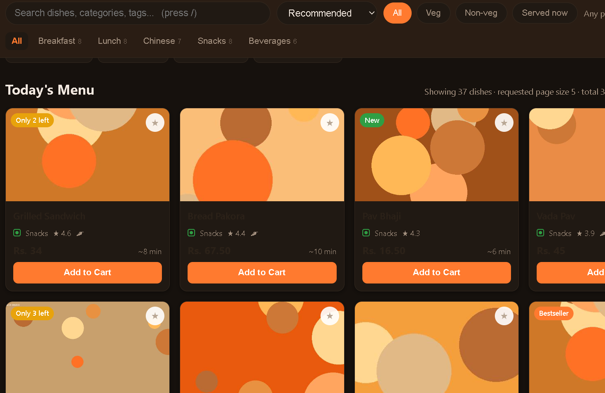
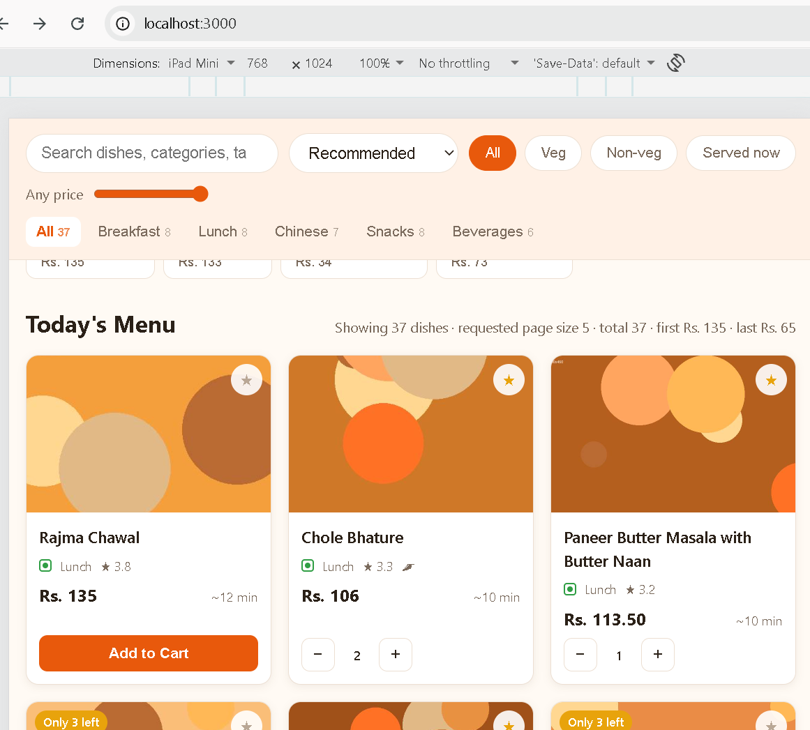
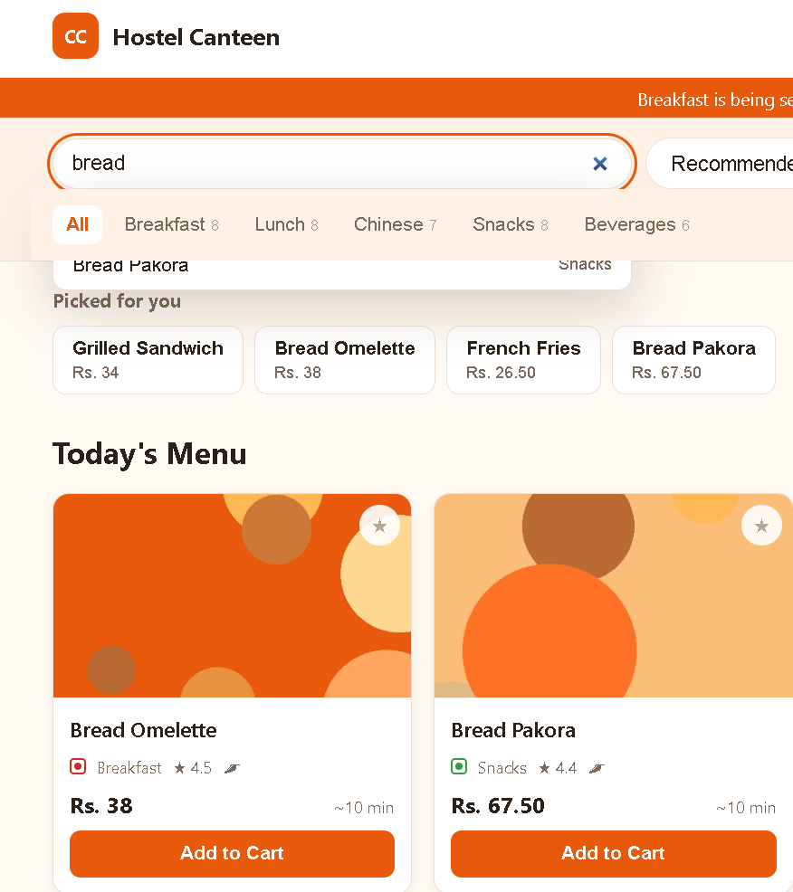
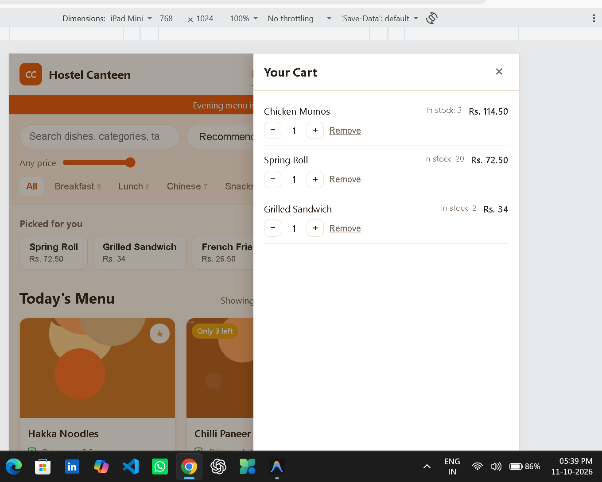

# Debug log

Your notes. One entry per bug you fixed, using the template below.

This file is read as carefully as your code. A correct fix you cannot
explain counts for little; a bug you could not fix but investigated
honestly still counts for something.

### CC-01 : "The search suggestions are behind everything"

**Reproduced:** Started typing a dish name("bread") in the search bar. The list of suggestions appeared, but some suggestions are hidden behind the menu category navigation bar. first suggestion and second partially part was not clickable.

**Cause:** The search suggestions dropdown (.cat-tabs) had an incorrect stacking order (z-index =40 ), causing other page elements to appear in front of it.this prevented clicks from reaching the suggestions.

**Fix:** Corrected stacking order (z-index = 0) so that it appears above the page content. Checked the parent containers for overflow restrictions and ensured that no overlapping elements block clicks on the suggestions.

**Checked:** All search suggestions are visible and clickable. Selecting a dish works correctly, and the dropdown displays above other page elements without being cut off.

**Time:** About 10 minutes, most of it spent identifying which element (css class- name from inspect) was covering the dropdown and why clicks were not reaching the suggestions.

### CC-02 : "Can't read anything in dark mode"

**Reproduced:** Switched the website to dark mode. Dish names and prices became almost invisible against the dark background, while the grey line underneath the dish name remained visible. 

**Cause:** The dark mode styles were not applying the correct text colors to dish names and prices. Some elements may have been using hardcoded dark text colors that blended into the dark background.

**Fix:** Removed conflicting hardcoded colors (.dish-body { color:#2b2118;}) and ensured all dish details follow the active theme.

**Checked:** Dish names, prices and descriptions are clearly readable in both light and dark modes. and the text colors are applied correctly when switching themes and opening the website.

**Time:** About 20 minutes, most of it spent tracking down conflicting text colors and checking which styles were overriding the dark mode theme.

### CC-04 : "The buttons don't work on my tablet"

**Reproduced:** Opened the website on a tablet and tapped the "Add to Cart" and star buttons to add and save dishes. Both buttons appeared normal, but tapping them did nothing. The same buttons worked correctly on a phone and desktop mode.

**Cause:** The tablet-specific CSS media query for screen widths between 761px and 900px created transparent pseudo-elements (.dish-card::after and .img-wrap::after) over the dish cards. that layer intercept taps on the buttons, preventing their click events from reaching the intended elements.

**Fix:** Removed the entire tablet-specific CSS block for the 761px–900px screen-width range, including the transparent pseudo-elements and their associated positioning and stacking rules. 

**Checked:** Tested the "Add to Cart" and star buttons on the affected tablet after removing the CSS block. Both buttons responded correctly, allowing dishes to be added to the cart and saved. The existing functionality on laptops and phones remained unaffected.

**Time:** About 40 minutes, most of it spent investigating tablet-specific touch interactions, inspecting CSS stacking and positioning, and testing the buttons after removing the problematic styles.

### CC-05: "The category bar scrolls away on my phone"

**Reproduced:** Opened the website on a phone and scrolled down through the menu dishes. The category and filter bar scrolled away instead of remaining visible at the top while browsing the menu.

**Cause:**  The .view container had overflow-x: hidden, which was interfering with the intended sticky positioning of the category and filter bar on smaller screens.

**Fix:** Changed overflow-x: hidden to overflow-x: visible inside the mobile CSS media query (max-width: 480px). This allowed the category and filter bar to remain visible at the top while scrolling through the menu.

**Checked:** Tested the website on a phone after updating the CSS. Verified that the category and filter bar remained visible while scrolling through the menu dishes.

**Time:** About 20 minutes, including investigating the mobile CSS overflow behavior, updating the property, and testing the scrolling behavior.

### CC-extra-bug-1 : "checkout option is not visible"

**How i noticed:**
i was trying to fix cc-4 on dimension = tablets i noticed that the checkout option is not visible on tablets  

**Reproduced:**Opened the website on an iPad Mini and viewed the cart panel. The cart items occupied too much vertical space, causing the coupon section, total and Checkout button to be pushed out of view.

**Cause:** The .cart-items container was taking up too much available space because of its flex sizing. This left insufficient room for the coupon section and checkout footer within the tablet's viewport.

**Fix:** Changed the .cart-items CSS property from flex: 1 to flex: 0.2, reducing the space allocated to the cart items and leaving more room for the checkout section.

**Checked:** The coupon section, subtotal, GST, total and Checkout button are now visible in the iPad Mini and all responsive dimensions layouts. The cart items remain scrollable, allowing users to access additional dishes.

**Time:** About 20 minutes, most of it spent adjusting the cart's flex layout and testing the checkout panel in tablet view.

### CC-06 : "Customers can order more than the available stock"

**Reproduced:** Added a dish to the cart until its quantity matched the available stock, then tried to increase the quantity again. The menu did let me increase the quantity greater then available stock same problem in every quantity increasing buttom (from menu , cart, dish detail )

**Cause:** The menu's increment button was disabled at the stock limit , so the click handler could not show a warning. The server also checked only whether a dish was sold out.  not  whether the requested quantity exceeded its remaining stock.

**Fix:** Kept the menu increment button active at the stock limit so the user sees an "Only ___ left in stock" warning. Added stock checks to cart quantity changes, order validation, and the final stock reservation.

**Checked:** Verified that an order for 2 items is rejected when only 1 is in stock, that an over-stock reservation is refused without changing stock, and that ordering exactly the available quantity remains valid. JavaScript syntax and editor diagnostics passed.

**Time:** About 3 hours, including checking the menu interaction and server-side stock validation. 

### CC-07: "Cancelling makes it worse"

**Reproduced:** Placed an order, then cancelled it. Instead of returning the reserved plates to available stock, the stock count decreased again.

**Cause:** The cancellation stock-release logic subtracted the order quantity from the current stock instead of adding it back.

**Fix:** Changed stock release to add each cancelled order line's quantity back to its dish. Kept the existing transition guard that rejects cancellation attempts on already-cancelled orders.

**Checked:** The smoke test verifies that cancelling an order restores one plate and that repeating the cancellation is rejected without restoring stock a second time.

**Time:** About 40 minutes, including tracing the cancellation flow, fixing the stock update, and adding regression coverage.

### CC-08: "An old coupon still works"

**Reproduced:** Quoted an order using `FRESHERS24`. The coupon was absent from the available-coupons list, but the quote pricing path could still apply it because it validated uses, order minimums, and slots without checking its expiry.

**Cause:** Coupon listing and order pricing used separate eligibility checks. Only the listing route checked `expiresAt`; quote and order pricing did not.

**Fix:** Added an expiry check to the shared `applyCoupon` pricing function. Expired coupons (and coupons with invalid expiry dates) now return no discount and an explicit expiry error, so both quotes and submitted orders reject them.

**Checked:** The smoke test asserts that `FRESHERS24` returns zero discount with the expiry error, guarding the pricing path rather than only checking that the coupon is hidden from the list.

### CC-extra-bug-2: "Order tracking is not working"

**How I noticed:** clicked on track order, order was not visible 

**Reproduced:** Placed an order and opened My Orders. The frontend requested `/api/orders?memberId=...`, but the server compared each order's member ID with a different, unset query parameter. The list therefore showed no orders, so the Track button was unavailable.

**Cause:** The member filter in the orders list route read `req.query.userId` instead of `req.query.memberId`.

**Fix:** Compare the order's `memberId` with the `memberId` query parameter used by the frontend.

**Checked:** Added a smoke-test regression check that a member's list includes their newly placed order and excludes orders belonging to other members.

## Could not fix

For anything you investigated but did not solve. Say what you tried and
where you got to. This is worth marks — leaving it blank when you got
stuck is not.

### CC-03 — "The menu is wider than my phone"

**What I tried:**
I couldn't find any bug that is mentioned , everything is looking fine on mobile screen as well.

**Where I got to:**
I inspected the menu container to identify the cause of the excessive width.
I checked for any fixed-width elements or large margins that might be contributing to the overflow.
I looked for any flexbox properties that could be causing the items to expand beyond the viewport.

**What I would try next:**
